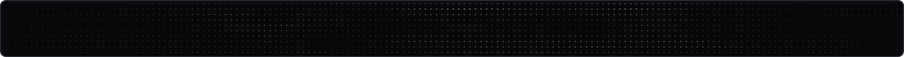

  <a href="https://m4lform.dev">
    <picture>
      <source media="(prefers-color-scheme: dark)" srcset="./assets/header-dark.png">
      <source media="(prefers-color-scheme: light)" srcset="./assets/header-light.png">
      
    </picture>
  </a>

  <a href="https://m4lform.dev">
    <picture>
      <source media="(prefers-color-scheme: dark)" srcset="./assets/card-site-dark.png">
      <source media="(prefers-color-scheme: light)" srcset="./assets/card-site-light.png">
      
    </picture>
  </a>

  <picture>
    <source media="(prefers-color-scheme: dark)" srcset="./assets/card-slot-1-dark.png">
    <source media="(prefers-color-scheme: light)" srcset="./assets/card-slot-1-light.png">
    
  </picture>&nbsp;&nbsp;<picture>
    <source media="(prefers-color-scheme: dark)" srcset="./assets/card-slot-2-dark.png">
    <source media="(prefers-color-scheme: light)" srcset="./assets/card-slot-2-light.png">
    
  </picture>

  <picture>
    <source media="(prefers-color-scheme: dark)" srcset="./assets/card-slot-3-dark.png">
    <source media="(prefers-color-scheme: light)" srcset="./assets/card-slot-3-light.png">
    
  </picture>&nbsp;&nbsp;<picture>
    <source media="(prefers-color-scheme: dark)" srcset="./assets/card-slot-4-dark.png">
    <source media="(prefers-color-scheme: light)" srcset="./assets/card-slot-4-light.png">
    
  </picture>

  <picture>
    <source media="(prefers-color-scheme: dark)" srcset="./assets/footer-dark.png">
    <source media="(prefers-color-scheme: light)" srcset="./assets/footer-light.png">
    
  </picture>

