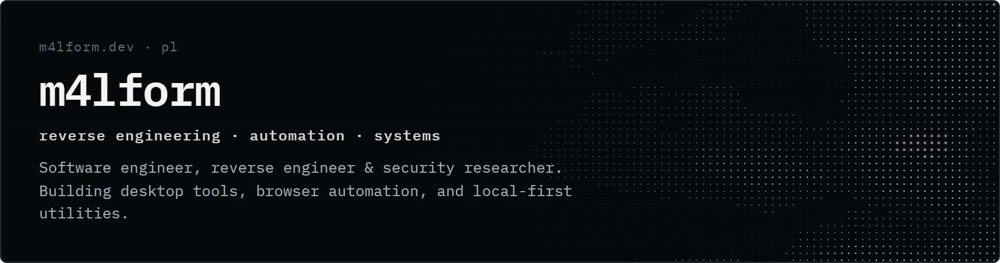
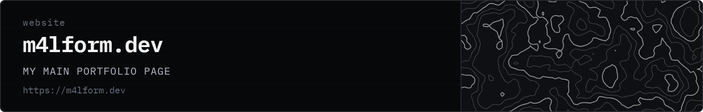

  <a href="https://m4lform.dev">
    <picture><source media="(prefers-color-scheme: dark)" srcset="./assets/header-dark.png"><source media="(prefers-color-scheme: light)" srcset="./assets/header-light.png"></picture>
  </a>

  <a href="https://m4lform.dev">
    <picture><source media="(prefers-color-scheme: dark)" srcset="./assets/card-site-dark.png"><source media="(prefers-color-scheme: light)" srcset="./assets/card-site-light.png"></picture>
  </a>

<picture><source media="(prefers-color-scheme: dark)" srcset="https://stats.m4lform.dev/card/stars.svg?theme=dark"><source media="(prefers-color-scheme: light)" srcset="https://stats.m4lform.dev/card/stars.svg?theme=light"></picture>&nbsp;&nbsp;<picture><source media="(prefers-color-scheme: dark)" srcset="https://stats.m4lform.dev/card/languages.svg?theme=dark"><source media="(prefers-color-scheme: light)" srcset="https://stats.m4lform.dev/card/languages.svg?theme=light"></picture>

<picture><source media="(prefers-color-scheme: dark)" srcset="https://stats.m4lform.dev/card/repos.svg?theme=dark"><source media="(prefers-color-scheme: light)" srcset="https://stats.m4lform.dev/card/repos.svg?theme=light"></picture>&nbsp;&nbsp;<picture><source media="(prefers-color-scheme: dark)" srcset="https://stats.m4lform.dev/card/telemetry.svg?theme=dark"><source media="(prefers-color-scheme: light)" srcset="https://stats.m4lform.dev/card/telemetry.svg?theme=light"></picture>

  <picture><source media="(prefers-color-scheme: dark)" srcset="https://stats.m4lform.dev/card/focus.svg?theme=dark"><source media="(prefers-color-scheme: light)" srcset="https://stats.m4lform.dev/card/focus.svg?theme=light"></picture>

